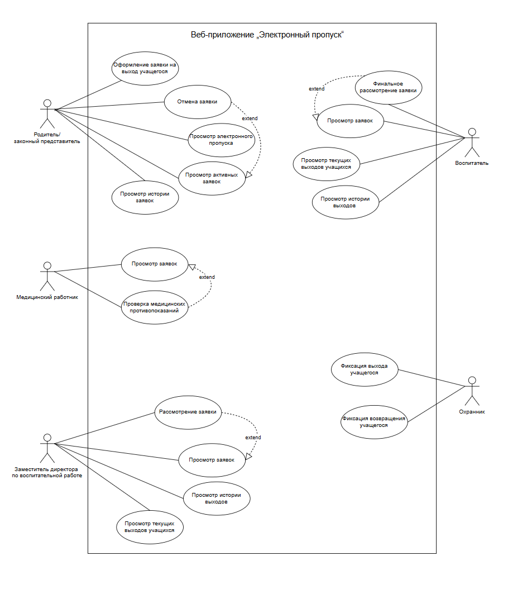

# Варианты использования

В данном разделе представлены варианты использования веб-приложения «Электронный пропуск», предназначенного для оформления и согласования заявок на выход учащихся за территорию гимназии-интерната.

## Диаграмма вариантов использования

Диаграмма отражает основных действующих лиц системы и доступные им варианты использования.

## Описание вариантов использования

| Идентификатор | Название |
|---|---|
| UC-01 | Оформление заявки на выход учащегося |
| UC-02 | Отмена заявки на выход учащегося |
| UC-03 | Просмотр активных заявок |
| UC-04 | Просмотр электронного пропуска |
| UC-05 | Просмотр истории заявок |
| UC-06 | Просмотр заявок |
| UC-07 | Проверка медицинских противопоказаний |
| UC-08 | Просмотр заявок |
| UC-09 | Рассмотрение заявки |
| UC-10 | Просмотр текущих выходов учащихся |
| UC-11 | Просмотр истории выходов |
| UC-12 | Просмотр заявок |
| UC-13 | Финальное рассмотрение заявки |
| UC-14 | Просмотр текущих выходов учащихся |
| UC-15 | Просмотр истории выходов |
| UC-16 | Фиксация выхода учащегося |
| UC-17 | Фиксация возвращения учащегося |

Полные описания вариантов использования представлены в отдельных файлах.

